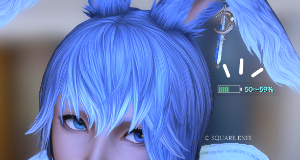
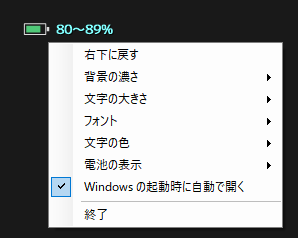

# DS4Battery

Windows に BluetoothやUSBでつないだ **DUALSHOCK 4 / DualSense** のバッテリー残量を、画面のすみに小さく最前面で表示する Windows 用の小さなアプリです。

「気づいたら残り15%だった」を防ぐために作りました。コントローラー本体が送ってくる電池の値をそのまま読んで表示します。



## できること

- 画面のすみに小さく、ほかのウィンドウより前に表示
- 電池の絵（10マス）と残量（例：`50〜59%`）を表示
- 残量で色が変わる：緑 → 黄色（39%以下）→ 赤・赤い枠（19%以下）
- USB ケーブルをつなぐと、充電中は稲妻のマークと残量、満充電になると「FULL」を表示
- マウスを乗せると、機種名と接続方法（Bluetooth / USB）を表示
- 左ドラッグで好きな位置へ移動可能
- 右クリックのメニューで見た目を調整できます
  - 右下に戻す
  - 背景の濃さ（なし／ほぼ透明／薄い／普通／濃い／不透明）
  - 文字の大きさ（5段階）
  - フォント変更（PCに入っているフォントから選択できます）
  - 文字の色変更
  - 電池の表示（10マス／コンパクト／電池の絵なし）
  - Windowsの起動時に自動で開く
  - 新しい版があるときは「新しい版があります → 更新する」（押すと自動で入れ替えて開き直します）
  - 終了



## 残量の表示について（なぜ「50〜59%」のような幅なのか）

DUALSHOCK 4・DualSense の本体は、残量を **10%きざみ（0〜10の11段階）** でしか送ってきません。どのアプリでもこれより細かい値は分からないため、ごまかさずに幅で表示しています（値の読み方は Linux の公式ドライバー hid-sony / hid-playstation と同じです：値 n ＝ n×10〜n×10+9%、10＝100%）。

## 使い方

1. [Releases](../../releases) から `DS4Battery.exe` をダウンロード
2. ダブルクリックで起動（インストール不要、1ファイルだけ）
3. やめるときは右クリック →「終了」

> 初回は Windows の SmartScreen（「Windows によって PC が保護されました」）が出ることがあります。署名のない個人制作のアプリのためです。「詳細情報」→「実行」で起動できます。不安な方は下の「自分でビルドする」をご利用ください。

### 対応

- Windows 10 / 11（.NET Framework 4.x、Windows に最初から入っています）
- DUALSHOCK 4（初代 CUH-ZCT1・新型 CUH-ZCT2）、Sony 純正 USB ワイヤレスアダプター
- DualSense（CFI-ZCT1）・DualSense Edge（CFI-ZCP1）
- 2台以上つないでいるときは、最初に見つかった1台を表示します
- Bluetooth・USB どちらの接続でも動きます

### 注意

- ゲームを「排他的フルスクリーン」で動かすと、上に重ねて表示できません。「ボーダーレス（ウィンドウ）」なら表示されます。
- DS4Windows などでコントローラーを「独占（exclusive）」している間は読めないことがあります。
  - **DS4Windows を使っていて、表示が「0〜9%」のまま動かないとき**は、DS4Windows の設定（Settings）にある「Hide DS4 Controller」のチェックを外してください。DS4Windows がコントローラーを独占しなくなり、正しい残量が出るようになります。
- Bluetooth 接続で、ほかのアプリがコントローラーをまだ使っていないとき、残量を読むためにコントローラーを「完全な報告」モードに切り替えます（Steam や DS4Windows が行うのと同じ操作です）。

### 更新について

v1.4.0 から、起動の30秒後と、その後1日1回、GitHub の最新リリースを確かめます。新しい版があると右クリックのメニューのいちばん上に「新しい版があります → 更新する」が出ます。押したときだけ、新しい `DS4Battery.exe` を落として GitHub の照合値（SHA-256）と一致するか確かめ、今の exe と入れ替えて開き直します。勝手に入れ替えることはありません。

- v1.3.1 までをお使いの方は、一度だけ手で v1.4.0 以降を落としてください。そこから先はメニューから更新できます。
- `Program Files` など書き込めない場所に置いた場合は更新できません。そのときは手で落としてください。
- 入れ替えた新しい版がウイルス対策ソフトに消された・起動を止められたときは、自動で元の版に戻し、そのまま使えます。
- 前の版は `DS4Battery.exe.old` として次の更新まで残します。あとから新しい版が消されてしまったときは、これを `DS4Battery.exe` に名前を変えれば元の版で使えます。
- 送るのは GitHub への問い合わせだけで、ほかの情報は送りません。

## 自分でビルドする

追加のインストールは不要です。Windows に入っている C# コンパイラでビルドできます。

```bat
C:\Windows\Microsoft.NET\Framework64\v4.0.30319\csc.exe /nologo /target:winexe /codepage:65001 /out:DS4Battery.exe /r:System.Windows.Forms.dll /r:System.Drawing.dll DS4Battery.cs
```

または `build.bat` をダブルクリックしてください。

## 設定の保存場所

`%APPDATA%\DS4Battery\` に位置・背景の濃さ・文字の設定を保存します。消せば最初の状態に戻ります。自動起動はタスク スケジューラの `DS4Battery`（ログオンの10秒後に起動）です（メニューから外せます）。前の版で使っていたレジストリの Run の登録は、新しい版を一度起動すると自動でタスクへ移ります（Run の登録は Windows の起動時に飛ばされることがあったため）。

## ライセンス

MIT License

「DUALSHOCK」「DualSense」は株式会社ソニー・インタラクティブエンタテインメントの登録商標です。このアプリはソニーとは関係のない個人制作のものです。
